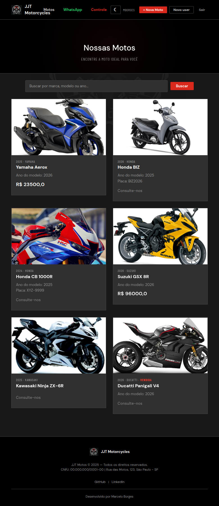
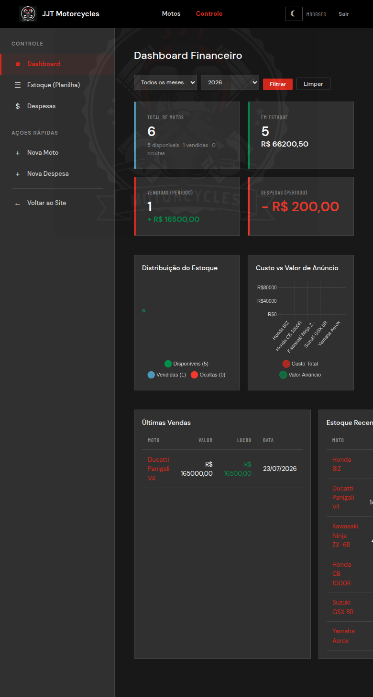
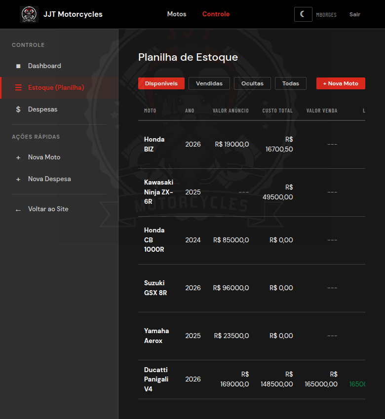

# 🏍️ JJT Motorcycles

**Sistema web completo para gestão de concessionária de motos** — catálogo público com design Ferrari, painel administrativo com controle de estoque, custos, vendas e lucratividade.


---

## ✨ Visão Geral

O **JJT Motorcycles** é um sistema Django de ponta a ponta que gerencia:

### 🌐 Site Público (Catálogo)
- Listagem de motos com grid responsivo e busca textual
- Detalhes individuais com carrossel de fotos (até 6 imagens)
- Geração automática de descrições técnicas via IA (OpenRouter)
- Preço com toggle "Consulte-nos" controlado pelo admin
- Badge "VENDIDA" para motos comercializadas
- Design escuro/claro com tema inspirado na Ferrari

### 🔐 Painel Administrativo
- CRUD completo de motos (criar, editar, deletar)
- Autenticação com 3 níveis de acesso
- Geração de descrição por IA com um clique

### 📊 Controle de Estoque e Custos (Fase 2)
- **Dashboard financeiro** com cards de resumo e gráficos Chart.js
- **Planilha de estoque** com custo total, valor de anúncio, lucro e margem
- **6 categorias de custo** por moto (aquisição, documento, frete, manutenção, multas, outros)
- **Registro de vendas** com cálculo automático de lucro
- **Despesas extras** (CRUD completo, vinculadas a moto ou gerais)
- **Toggle visibilidade** — ocultar/exibir moto no site público
- **Filtros** por mês, ano e status
- Tema dark/light integrado

---

## 🖼️ Screenshots

| Lista de Motos | Dashboard Financeiro | Planilha de Estoque |
|:---:|:---:|:---:|
|  |  |  |

---

## 📂 Estrutura do Projeto

```
Dj_motos_JJT_v2/
├── app/                        # Configuração principal do Django
│   ├── settings.py             # Configurações (DB, apps, static, media)
│   ├── urls.py                 # Rotas principais
│   ├── static/css/
│   │   ├── ferrari.css         # Design System Ferrari (1250+ linhas)
│   │   └── custom.css          # CSS auxiliar (carrossel, tabelas)
│   └── templates/
│       ├── base.html           # Template base (navbar, footer, tema)
│       └── base_old.html       # Backup do layout anterior
│
├── motos/                      # App de catálogo de motos
│   ├── models.py               # Brand, Motos, MotoInventory
│   ├── views.py                # ListView, DetailView, CRUD, generate_description
│   ├── forms.py                # MotoModelForm (brand como text input)
│   ├── signals.py              # Auto-update MotoInventory
│   ├── admin.py                # Admin config
│   └── templates/
│       ├── motos.html          # Grid de motos + busca
│       ├── moto_detail.html    # Detalhes + carrossel + IA
│       ├── new_moto.html       # Formulário de cadastro
│       ├── moto_update.html    # Formulário de edição
│       └── moto_delete.html    # Confirmação de exclusão
│
├── accounts/                   # App de autenticação
│   ├── views.py                # Login, Register, Logout
│   └── templates/
│       ├── login.html
│       └── register.html
│
├── stockcontrol/               # App de controle de estoque (Fase 2)
│   ├── models.py               # MotoStock, ExtraExpense
│   ├── views.py                # Dashboard, Lista, Custos, Vendas, Despesas
│   ├── forms.py                # StockCostForm, SaleForm, ExtraExpenseForm
│   ├── urls.py                 # 12 rotas /stock/*
│   ├── decorators.py           # financeiro_required
│   ├── signals.py              # Auto-cria MotoStock ao cadastrar moto
│   ├── admin.py                # Admin config
│   ├── PRD.md                  # Documento de requisitos do módulo
│   └── templates/stockcontrol/
│       ├── base_stock.html     # Base com sidebar
│       ├── dashboard.html      # Dashboard financeiro
│       ├── stock_list.html     # Planilha de estoque
│       ├── stock_detail.html   # Custos detalhados
│       ├── expense_form.html   # Editar custos
│       ├── sale_form.html      # Registrar venda
│       ├── extra_expense_list.html
│       ├── extra_expense_form.html
│       └── extra_expense_confirm_delete.html
│
├── screenshots/                # Capturas de tela do projeto
├── media/                      # Uploads de fotos (gitignored)
├── requirements.txt            # Dependências Python
├── manage.py                   # CLI do Django
├── LINKEDIN_POST.md            # Post de apresentação
└── .hermes/                    # Planos de desenvolvimento
    └── PLANO_REDESIGN.md       # Roadmap do redesign Ferrari
```

---

## 🚀 Stack Tecnológica

| Camada | Tecnologia |
|--------|-----------|
| **Backend** | Django 5.2 (Python 3.12) |
| **Banco** | PostgreSQL 16 |
| **Frontend** | CSS Puro (Design System próprio) |
| **Gráficos** | Chart.js (dashboard) |
| **IA** | OpenRouter API (NVIDIA Nemotron grátis) |
| **Fotos** | Django ImageField (até 6 uploads) |
| **Autenticação** | Django Auth + Grupos (gerente/financeiro) |

---

## 👥 Níveis de Acesso

| Grupo | Acesso |
|-------|--------|
| **Visitante** (sem login) | Apenas visualizar catálogo público |
| **gerente** | CRUD completo de motos |
| **financeiro** | CRUD de motos + todo módulo /stock/* |

---

## 🔌 Funcionalidades em Detalhe

### 🌐 Site Público
- Grid responsivo com cards estilo Ferrari
- Busca por modelo (texto livre)
- Carrossel de fotos com setas e dots
- Preço com toggle "Consulte-nos" (controlado por admin)
- Badge "VENDIDA" em motos comercializadas
- Tema dark/light com persistência em localStorage
- Footer com logo, CNPJ, endereço, créditos

### 🤖 Geração de Descrição por IA
Endpoint `/motos/gerar-descricao/` que:
1. Recebe marca, modelo, anos via POST
2. Envia para OpenRouter (modelo NVIDIA Nemotron grátis)
3. Retorna descrição profissional em português
4. Adapta o tom: alta cilindrada destaca cavalaria, baixa cilindrada destaca consumo

### 📊 Dashboard Financeiro
- Cards: total de motos, disponíveis, vendidas, ocultas
- Valor total em estoque, lucro do período, despesas
- Gráfico de barras: custo vs valor anunciado (top 10)
- Últimas 5 vendas
- Filtros por mês e ano

### 📋 Planilha de Estoque
- Todas as motos com: custo total, valor anúncio, lucro, margem
- Ações: detalhar custos, registrar venda, ocultar/exibir
- Filtro por status (disponível, vendida, oculta)

### 💰 Controle de Custos por Moto
6 categorias de custo:
1. **Aquisição** — valor de compra/entrada
2. **Documento** — taxas de transferência, licenciamento
3. **Transporte/Frete** — frete, transferência
4. **Manutenção/Preparação** — revisão, reparos
5. **Multas** — multas pendentes/pagas
6. **Outros** — despesas não previstas

### 🏷️ Despesas Extras
CRUD completo com categorias: Administrativo, Marketing, Aluguel, Salários, Impostos, Ferramentas, Outros. Podem ser vinculadas a uma moto específica ou gerais.

---

## 🔐 Credenciais Padrão (Desenvolvimento)

| Papel | Usuário | Senha |
|-------|---------|-------|
| Admin Django | `mborges` | `7596` |

---

## 📄 Licença

Este projeto é de uso pessoal/ comercial. Desenvolvido por **Marcelo Borges**.

---

<p align="center">
  <sub>Feito com 🏍️ por Marcelo Borges</sub><br>
  <a href="https://github.com/Marcel0Borg3s">GitHub</a> ·
  <a href="https://www.linkedin.com/in/mborgesx">LinkedIn</a>
</p>
